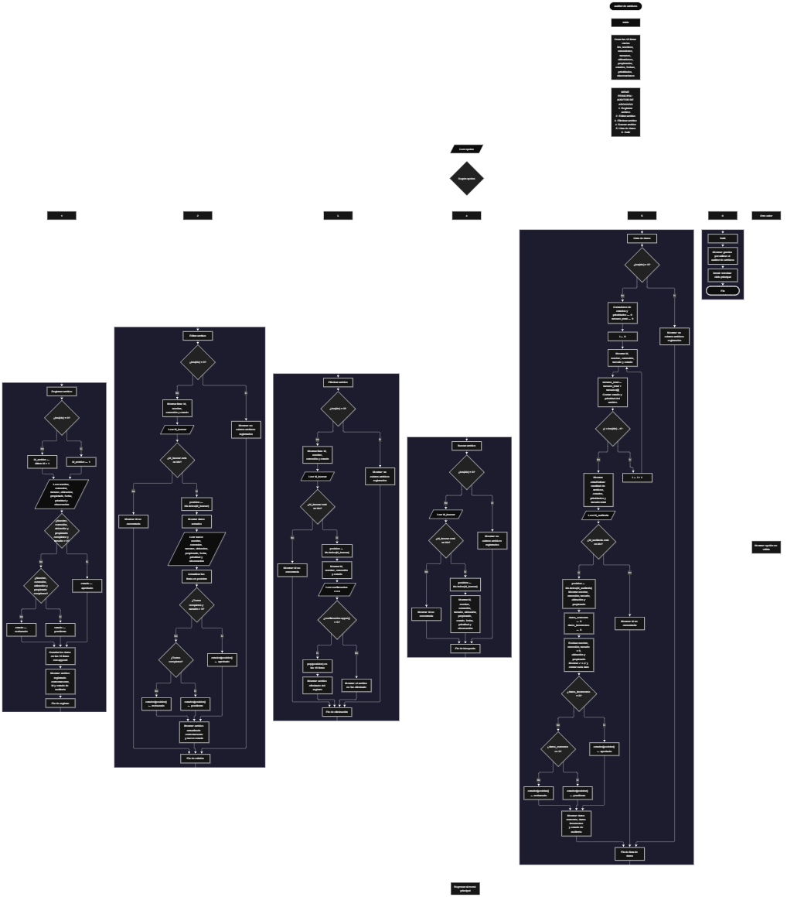

Este proyecto, llamado <b>auditor de archivos</b>, fue desarrollado en <b>python</b> como un ejercicio práctico para fortalecer la lógica de programación mediante la creación de un sistema de auditoría y gestión de archivos desde la consola. El programa cuenta con un menú principal de seis opciones que permite <b>registrar, editar, eliminar, buscar y listar</b> los archivos registrados, además de consultar estadísticas y realizar la auditoría de un archivo específico. Cada archivo almacena datos como el nombre, la extensión, el tamaño, la ubicación, el propietario, la fecha de auditoría, la prioridad y una observación, utilizando <b>listas paralelas</b> que guardan la información durante la ejecución del programa. Durante su desarrollo se aplicaron conceptos fundamentales de programación, como variables, listas, estructuras condicionales, ciclos repetitivos y entrada y salida de datos, además de procesos para buscar, modificar, eliminar, contar y validar registros. Este proyecto permite poner en práctica los conocimientos adquiridos en python y sirve como base para desarrollar sistemas de gestión más avanzados utilizando otros lenguajes y tecnologías.

<h2 align="center">⚙️ Funcionamiento del menú principal</h2>

### ➕ Registrar archivo

La opción <b>1) registrar archivo</b> permite agregar un nuevo archivo al sistema. Primero, el programa genera la <b>id</b> de forma automática: si la lista <b>ids</b> está vacía, la id es <b>1</b>; en caso contrario, toma la última id registrada y le suma uno. Después, solicita el <b>nombre, la extensión, el tamaño en MB, la ubicación, el propietario, la fecha de auditoría, la prioridad (alta, media o baja) y una observación</b>. Con los datos ingresados, el programa asigna automáticamente un <b>estado de auditoría</b>: <b>aprobado</b> si el nombre, la extensión, la ubicación y el propietario están completos y el tamaño es mayor que 0; <b>pendiente</b> si los textos están completos pero el tamaño no es válido; y <b>rechazado</b> si falta alguno de esos datos de texto. Finalmente, guarda cada dato en su respectiva lista y muestra los mensajes <b>"archivo registrado correctamente."</b>, la id asignada y el estado de auditoría.

### ✏️ Editar archivo

La opción <b>2) editar archivo</b> permite modificar la información de un archivo registrado. Primero, el programa comprueba si existen archivos almacenados. Si no hay registros, muestra el mensaje <b>"no existen archivos registrados."</b>. En caso contrario, presenta una lista con la id, el nombre, la extensión y el estado de cada archivo, y solicita la id del archivo que se desea editar. Si la id existe en la lista <b>ids</b>, el programa obtiene su posición con <b>ids.index()</b>, muestra los datos actuales y solicita el nuevo nombre, extensión, tamaño, ubicación, propietario, fecha de auditoría, prioridad y observación, actualizando directamente los valores de las listas. Después, vuelve a evaluar las mismas reglas del registro para asignar el nuevo estado y muestra los mensajes <b>"archivo actualizado correctamente."</b> y el nuevo estado. Si la id no existe, informa <b>"id no encontrada."</b>.

### 🗑️ Eliminar archivo

La opción <b>3) eliminar archivo</b> permite quitar un archivo del registro mediante su id. Antes de comenzar, el programa comprueba que existan archivos almacenados. Si la lista está vacía, muestra el mensaje <b>"no existen archivos registrados."</b>. Si hay registros disponibles, presenta una lista con la id, el nombre, la extensión y el estado de cada archivo, y solicita la id del archivo que se desea eliminar. Si la id existe, muestra sus datos principales y pide una <b>confirmación (s/n)</b>. Cuando la respuesta es <b>S</b> (sin importar si se escribe en mayúscula o minúscula), utiliza el método <b>pop()</b> en las diez listas para eliminar la información de esa posición y muestra el mensaje <b>"archivo eliminado del registro."</b>. Si la respuesta es diferente, muestra <b>"el archivo no fue eliminado."</b>. Si la id no existe, informa <b>"id no encontrada."</b>.

### 🔎 Buscar archivo

La opción <b>4) buscar archivo</b> permite localizar un archivo mediante su id. Primero, el programa comprueba si existen archivos registrados. Si la lista está vacía, muestra el mensaje <b>"no existen archivos registrados."</b>. En caso contrario, solicita la id del archivo y verifica si se encuentra en la lista <b>ids</b>. Si existe, obtiene su posición con <b>ids.index()</b> y muestra todos sus datos: <b>id, nombre, extensión, tamaño, ubicación, propietario, estado, fecha de auditoría, prioridad y observación</b>. Si la id no se encuentra, presenta el mensaje <b>"id no encontrada."</b>.

### 📋 Lista de datos

La opción <b>5) lista de datos</b> permite visualizar todos los archivos registrados y consultar sus estadísticas. Antes de mostrar la información, el programa comprueba si existen archivos. Si no hay registros, presenta el mensaje <b>"no existen archivos registrados."</b>. Si hay archivos disponibles, utiliza un ciclo <b>for</b> para recorrer las listas y mostrar la id, el nombre, la extensión, el tamaño y el estado de cada uno. Durante el recorrido, el programa acumula el <b>tamaño total</b> y cuenta cuántos archivos son <b>aprobados, pendientes y rechazados</b>, así como cuántos tienen prioridad <b>alta, media y baja</b>. Al finalizar, muestra las estadísticas del auditor: cantidad de archivos, conteo por estado, conteo por prioridad y tamaño total en MB.

#### 🧾 Auditoría de archivo

Después de mostrar las estadísticas, la misma opción permite <b>auditar un archivo específico</b>. El programa solicita la id del archivo y, si existe, muestra su nombre, extensión, tamaño, ubicación y propietario. Luego revisa cinco datos: <b>nombre registrado, extensión registrada, tamaño válido (mayor que 0), ubicación registrada y propietario registrado</b>. Cada dato correcto se muestra con ✓ y cada dato incorrecto con ✗, y el programa cuenta los <b>datos correctos</b> y los <b>datos incorrectos</b>. Con ese resultado asigna el estado del archivo: <b>APROBADO</b> si no hay datos incorrectos, <b>PENDIENTE</b> si hay al menos tres datos correctos y <b>RECHAZADO</b> en los demás casos. Si la id no existe, muestra el mensaje <b>"id no encontrada."</b>.

### 🚪 Salir del menú principal

La opción <b>6) salir</b> finaliza la ejecución del programa y muestra el mensaje <b>"gracias por utilizar el auditor de archivos."</b>. El menú principal se encuentra dentro de un ciclo <b>while True</b>, que mantiene el programa en funcionamiento mientras se realizan las operaciones disponibles. Al seleccionar la opción 6, se utiliza la instrucción <b>break</b> para romper el ciclo y terminar el programa.

<h2 align="center">🧠 Temas aplicados en el proyecto</h2>

### 📦 Variables

En este proyecto se utilizan variables para guardar la opción seleccionada en el menú, capturar los datos de cada archivo, controlar la posición de un registro dentro de las listas, confirmar la eliminación, acumular las estadísticas y contar los datos correctos e incorrectos durante la auditoría. Cada variable cumple una función específica dentro de las operaciones del sistema.

🔢 **opcion:** Almacena la opción seleccionada por el usuario en el menú principal.

🆔 **id_archivo:** Almacena la id generada automáticamente para un nuevo archivo.

📝 **nombre, extension, tamano, ubicacion, propietario, fecha, prioridad y observacion:** Almacenan temporalmente los datos que el usuario ingresa al registrar un archivo.

🏷️ **estado:** Almacena el estado de auditoría asignado (aprobado, pendiente o rechazado).

🔎 **id_buscar:** Almacena la id que el usuario ingresa para editar, eliminar o buscar un archivo.

📍 **posicion:** Almacena la posición del archivo dentro de las listas, obtenida con `ids.index()`.

✅ **confirmacion:** Almacena la respuesta (s/n) para confirmar la eliminación de un archivo.

📊 **aprobados, pendientes y rechazados:** Contadores de archivos según su estado.

🚦 **prioridad_alta, prioridad_media y prioridad_baja:** Contadores de archivos según su prioridad.

💾 **tamano_total:** Acumula el tamaño en MB de todos los archivos registrados.

🧾 **id_auditoria, datos_correctos y datos_incorrectos:** Controlan el archivo auditado y el resultado de la revisión de sus datos.

🔄 **i:** Funciona como contador en los ciclos `for` que recorren las listas.

### 🗃️ Listas

En este proyecto se utilizan diez listas relacionadas con los datos de cada archivo. Todas utilizan el mismo índice para representar la información correspondiente a un mismo archivo. Por ejemplo, los datos de un archivo almacenado en la posición <b>0</b> se encuentran distribuidos entre <b>ids[0], nombres[0], extensiones[0]</b> y el resto de las listas. Esta organización permite recorrer, buscar, modificar, mostrar y eliminar los archivos de manera ordenada.

🆔 **ids:** Almacena la id única de cada archivo.

📝 **nombres:** Almacena los nombres de los archivos.

📎 **extensiones:** Almacena las extensiones de los archivos.

💽 **tamanos:** Almacena el tamaño en MB de cada archivo.

📁 **ubicaciones:** Almacena la ubicación de cada archivo.

👤 **propietarios:** Almacena el propietario de cada archivo.

🏷️ **estados:** Almacena el estado de auditoría de cada archivo.

📅 **fechas:** Almacena la fecha de auditoría de cada archivo.

🚦 **prioridades:** Almacena la prioridad de cada archivo.

🗒️ **observaciones:** Almacena la observación registrada para cada archivo.

### 🔀 Estructuras condicionales

En este proyecto se utilizan las estructuras <b>if</b>, <b>elif</b> y <b>else</b> para ejecutar la opción elegida en el menú, comprobar si existen archivos antes de realizar determinadas operaciones, verificar si una id existe, asignar el estado de cada archivo según sus datos, confirmar la eliminación y clasificar los archivos por estado y prioridad. Estas condiciones permiten que el programa responda de manera diferente según los datos ingresados y el estado del registro.

### 🔄 Estructuras repetitivas

En este proyecto se utilizan los ciclos <b>while</b> y <b>for</b>. El ciclo <b>while True</b> mantiene activo el menú principal para que el usuario pueda ejecutar diferentes operaciones hasta elegir la opción de salida. Por otro lado, el ciclo <b>for</b> con <b>range(len(ids))</b> permite recorrer las listas para mostrar los archivos, acumular el tamaño total y contar los estados y las prioridades.

### 🧰 Métodos de listas

El programa utiliza métodos propios de las listas de python para administrar los registros. El método <b>append()</b> agrega los datos de un nuevo archivo al final de cada lista; el método <b>index()</b> obtiene la posición de una id dentro de la lista <b>ids</b>; y el método <b>pop()</b> elimina la información de una posición en las diez listas al eliminar un archivo. También se utiliza <b>len()</b> para comprobar si hay registros y para conocer su cantidad total.

### 🔡 Manejo de texto

El programa utiliza los métodos <b>upper()</b> y <b>lower()</b> para comparar textos sin importar si se escriben en mayúsculas o minúsculas. Con <b>upper()</b> se evalúa la confirmación de eliminación (S/N), y con <b>lower()</b> se comparan los estados y las prioridades al calcular las estadísticas. Además, se utilizan <b>f-strings</b> para mostrar de forma ordenada la información de cada archivo en una sola línea.

### 🔁 Asignación automática de estado

Cada vez que se registra o se edita un archivo, el programa evalúa sus datos mediante condiciones combinadas con <b>and</b> y asigna el estado de forma automática. Además, la auditoría revisa los cinco datos principales y vuelve a calcular el estado a partir de la cantidad de datos correctos e incorrectos, lo que permite mantener actualizada la información de cada archivo.

<h2 align="center">¿Cómo se implementaron las operaciones crud en el proyecto?</h2>

Las operaciones <b>crud</b> se implementaron mediante las opciones del menú principal, permitiendo administrar los archivos registrados. La operación <b>crear</b> corresponde a <b>registrar archivo</b>, donde se introducen los datos de un nuevo archivo; <b>leer</b> se realiza mediante las opciones <b>buscar archivo y lista de datos</b>; <b>actualizar</b> corresponde a <b>editar archivo</b>, donde se modifican los datos de un archivo registrado; y <b>eliminar</b> se realiza mediante la opción <b>eliminar archivo</b>. Estas operaciones utilizan variables, listas, condicionales y ciclos para gestionar la información almacenada temporalmente durante la ejecución del programa.

<h2 align="center">Diagrama de flujo del proyecto</h2>

<h2 align="center">🛡️ Validaciones del programa</h2>

### 📭 No existen archivos registrados

Esta validación se utiliza en las opciones de <b>editar, eliminar, buscar y lista de datos</b>. El programa comprueba si la lista <b>ids</b> tiene cero elementos y, si no existen archivos registrados, muestra el mensaje <b>"no existen archivos registrados."</b>. Esta comprobación evita continuar con las operaciones que necesitan información almacenada cuando el registro está vacío.

### ❌ Id no encontrada

Esta validación se utiliza al editar, eliminar, buscar y auditar archivos. El programa comprueba si la id ingresada se encuentra en la lista <b>ids</b> mediante la condición <b>id_buscar in ids</b>. Si la id existe, obtiene su posición y continúa con la operación. En caso contrario, muestra el mensaje <b>"id no encontrada."</b>, evitando modificar, eliminar o consultar un archivo que no existe.

### ✅ Confirmación de eliminación

Antes de eliminar un archivo, el programa muestra sus datos principales y solicita una confirmación. Solo si el usuario responde <b>s</b> o <b>S</b> se eliminan los datos de las listas. Con cualquier otra respuesta, el archivo se conserva y se muestra el mensaje <b>"el archivo no fue eliminado."</b>.

### 🏷️ Estado de auditoría

Al registrar o editar un archivo, el programa valida que el nombre, la extensión, la ubicación y el propietario no estén vacíos y que el tamaño sea mayor que <b>0</b>. Según el resultado, asigna el estado <b>aprobado, pendiente o rechazado</b>. En la auditoría, el programa revisa cada dato con ✓ o ✗ y calcula el estado final según la cantidad de datos correctos e incorrectos.

### ⚠️ Opción inválida

La estructura condicional del menú incluye un bloque <b>else</b> que muestra el mensaje <b>"opción no válida."</b> cuando el usuario introduce un valor que no corresponde a ninguna de las opciones definidas en el menú.

### 📝 Aspectos por mejorar

El programa no valida que los datos numéricos (el tamaño y las ids) se ingresen correctamente, por lo que escribir letras en esos campos produce un error. Tampoco valida que la prioridad sea alta, media o baja ni el formato de la fecha de auditoría. Estas validaciones pueden agregarse en versiones posteriores utilizando <b>try/except</b> y ciclos de repetición hasta que el dato sea válido.

<h2 align="center">🎯 Objetivo del proyecto</h2>

El objetivo principal de este proyecto es fortalecer la <b>lógica de programación</b> mediante el desarrollo de un sistema de auditoría de archivos en <b>python</b>. A través de su construcción se busca aplicar los conocimientos adquiridos sobre variables, listas, estructuras condicionales y ciclos repetitivos, integrándolos para resolver un problema de manera organizada. Además, el proyecto permite comprender cómo registrar, consultar, modificar, eliminar y auditar información en una aplicación de consola, estableciendo una base para desarrollar sistemas de gestión más completos con otros lenguajes y tecnologías.

